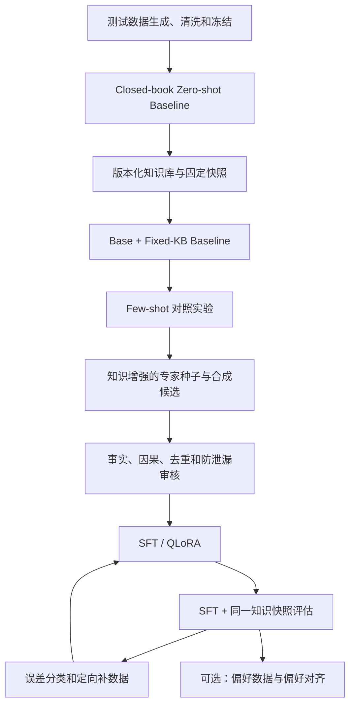

# 项目整体设计

状态：Active Draft v0.1  
最后更新：2026-08-26

## 1. 项目目标

增强大模型在英雄联盟 BP 阶段对静态阵容的分析能力，使模型能够：

- 基于指定版本的可追溯知识，准确使用英雄定位、伤害结构、控制链、射程、前排与清线能力。
- 根据阵容机制给出双方阵容画像、关键交互、制胜条件和前中后期发力点。
- 只在局部对位显著影响线权、支援、野区或资源时，将其聚合为阵容级结论。
- 在信息不足或非常规分路下主动表达不确定性，减少机制幻觉。
- 稳定输出可机器解析的结构化结果。

## 2. 当前范围

当前输入只覆盖 BP 结束后的静态信息：

- 场景标签与一句话背景描述。
- 蓝红双方五个位置的英雄。

当前不覆盖：

- 击杀、金币、装备、防御塔和地图资源等动态对局状态。
- 选手熟练度、队伍风格、符文、召唤师技能和具体执行水平。
- 未明确版本时的精确冷却、伤害或属性数值。
- 对真实比赛胜率的统计预测。
- 逐路控线、换血细节、刷野路线、Gank 时间、出装、技能加点等操作教学。

因此，第一阶段评估的是“匹配位置后的静态阵容机制分析是否成立”，不是寻找唯一正确
战术。局部对位的全局影响属于阵容分析；完整的各分路打法生成留作后续独立阶段。
目标输出契约见[静态阵容分析输出契约](LINEUP_ANALYSIS_OUTPUT_SCHEMA.md)。

## 3. 总体工作流

## 4. 阶段定义

### 阶段 0：测试数据引擎

目标是生成和清洗结构合法、实体合法、类别分布满足要求的测试输入。

当前状态：已完成 50 条 baseline 测试输入，类别缺口为 0。结构清洗不等于
阵容语义已经获得专家背书。

### 阶段 1：Closed-book Zero-shot Baseline

使用未做 LoL 微调、且不接外部知识库的 Qwen2.5-7B-Instruct，在冻结测试集上
确定性推理。EXP-0001 的事实与规则评判目标固定为 Data Dragon 16.16.1，官方补丁
别名为 26.16，知识截止日为 2026-08-21。报告按五个一级能力
维度组织，其中事实错误用于诊断知识缺口，交互、整体推演和因果错误用于定位 SFT 需求。

当前状态：`Lineup Analysis Output Schema v2` 已接受并具备机器 Schema、说明性示例与
回归测试；现有推理代码仍输出历史 v1 的全局分析和四路策略。正式运行前必须先迁移
Prompt、程序校验、Judge 和人工审核，并确认 E1～E5 Rubric 与 v2 的兼容边界。

### 阶段 1.5：版本化知识库与 Fixed-KB Baseline

把英雄和游戏规则的可变事实放入外部知识库。生产环境可动态更新；正式实验绑定
指定 ruleset 与固定知识快照。首个知识快照主版本为 Data Dragon 16.16.1；先运行
基座模型 + 固定知识库，
测量检索和知识使用收益。

当前状态：Champion Knowledge Card v2、728 份固定来源、173 张英雄卡、官方称号解析
和蓝红方/位置绑定 Prompt 已实现；当前质量状态为 `source_grounded_auto`。完整十卡的
两轮 9 条开发实验中，fixed-KB 隐藏 A/B 分别只胜 2/9、3/9，并且各有 1 条 JSON 非法。
历史 `compact-mechanics-v1` 在 `DEV-KB-0003` 降低了 token、延迟和格式失败，但将
普通英雄五个技能槽位裁成四个，造成关键机制缺失，已弃用且只作历史复现。
`compact-mechanics-v2` 已在 `DEV-KB-0004` 的同一 9 条验证：Prompt 槽位覆盖 450/450，
但 fixed-KB 机制接受度 0/9 完全通过，仍出现跨英雄模板、槽位错绑和辅助遗漏；未调用
Judge API。`DEV-KB-0005` 随后以 GPT-5.6-sol 生成完全相同的 9 个 fixed-KB Prompt，
相对注入 KB 的机制接受度提高到 6/9，端到端真实机制为 5/9；残余错误包括奎因隐身、
莫甘娜沉默和一次阵营混淆，并暴露卡莉丝塔 R 誓约者条件的 KB 漏项。该结果支持“模型
容量与知识绑定能力是 7B 失败的重要因素”，但不支持取消结构化事实和校验层。正式
base+fixed-KB 仍未运行。KB 条件漏项与知识使用验证仍待处理；当前先完成输出契约 v2
的运行链路迁移，不扩到正式 50 条 fixed-KB。
详细约束见
[知识库设计](KNOWLEDGE_BASE_DESIGN.md)。

### 阶段 2：Few-shot 对照

使用少量、与测试集隔离的专家示例进行 0/1/3/5-shot 对照。知识库可用后，正式
对照应绑定与后续 SFT 相同的固定知识快照。该阶段不更新模型权重，用于判断提示示范
是否足以改善分析范式。

当前状态：未开始。

### 阶段 3：SFT / QLoRA

先构建 200～500 条高质量、包含固定知识上下文的 pilot 数据，在单张 RTX 4090
上进行 QLoRA。SFT 主要训练阵容交互、整体推演和制胜条件，不承担长期记忆全部
版本事实。根据验证集和固定测试集的错误类型，再决定是否扩展到 1,000～3,000 条。
数据采集由[能力分类体系](CAPABILITY_TAXONOMY.md)与 baseline 错误分布共同驱动，
具体覆盖目标和来源门槛见[数据需求矩阵](DATA_REQUIREMENTS_MATRIX.md)。

当前状态：未开始。

### 阶段 4：误差驱动迭代与可选偏好对齐

对事实错误、逻辑矛盾、模板化策略和无依据断言分别统计，定向补充数据。
只有当 SFT 已稳定、且确有多个合理答案需要排序时，才考虑偏好对齐。

当前状态：未开始。

## 5. 评估架构

Baseline 报告按 `E1`～`E5` 五个一级维度组织，19 个二级标签只用于错误定位。
检查项、封顶、数据集汇总和人工一致性规则见
[评分标准](EVALUATION_RUBRIC.md)。
评估执行仍分为三层，不能用单一分数替代：

1. 程序检查：JSON、Schema、字段类型和硬约束。
2. LLM Judge：事实与机制准确度、战术因果自洽性。
3. 人工抽查：校准 Judge，识别明确事实错误、逻辑矛盾和无依据断言。

人工评审不负责确定唯一最佳战术。主观性较高的战术优劣，未来优先采用
A/B 成对比较；明确事实错误优先采用带证据的错误标签。

## 6. 实验可比性原则

在比较 zero-shot、few-shot 和 SFT 时，应尽量只改变一个变量：

- 使用相同冻结测试集。
- 使用相同输出 Schema 和指标定义。
- 使用确定性解码或明确记录随机种子与采样参数。
- 保留完整模型、Prompt、数据、代码和 Judge 版本。
- API 失败不伪装成低分，应单独统计。
- 训练数据和 few-shot 示例不得包含测试样本。
- 对比 base+KB 与 SFT+KB 时必须使用相同 ruleset、知识快照和检索逻辑。

## 7. 当前主要风险

- **版本漂移**：测试数据没有原始创作 ruleset，英雄机制可能随版本变化。
- **知识漂移**：若正式实验使用动态知识库而不固定快照，结果将无法复现。
- **测试泄漏**：未来合成 SFT 数据时可能生成与测试阵容高度相似的样本。
- **任务欠定**：只有 BP 信息时，多个战术都可能成立。
- **描述泄漏**：`scenario_description` 已概括部分阵容意图，可能降低任务难度。
- **Judge 偏差**：LLM Judge 可能被文风影响或自身存在英雄知识错误。
- **文档漂移**：代码、数据和文档若不在同一次修改中更新，会失去可信度。

## 8. 待决问题

- Baseline v2 是否移除或隐藏 `scenario_description`，测试纯阵容分析。
- 后续跨 Data Dragon 构建实验如何新建快照并保持与 16.16.1 结果可比。
- 人工审核错误标签的最终枚举和审核者一致率指标。
- 逐技能原子事实、fact ID 引用和确定性校验能否改善 7B 的跨实体与槽位错绑。
- Evaluation Rubric 和 Judge 如何在不要求逐路打法的前提下适配输出契约 v2。
- 实验配置何时从脚本常量迁移到版本化 YAML 和 Prompt 文件。
